# Gallery

Click a picture to see it full size.

<!-- one figure per screenshot: a thumbnail <name>_TH.png linked to <name>.png, both in images/gallery/,
     and a one-line caption under it, in the World Atlas or the Amateur Radio column; the columns'
     layout is .gallery in templates/my-template/public/main.css -->

  

    <h2>World Atlas</h2>
    <figure>
      
      <figcaption>World view</figcaption>
    </figure>
    <figure>
      <a href="images/gallery/globe.png">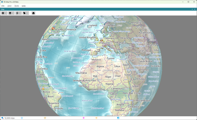</a>
      <figcaption>Globe</figcaption>
    </figure>
    <figure>
      <a href="images/gallery/grayline.png">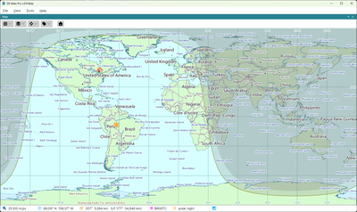</a>
      <figcaption>Gray Line</figcaption>
    </figure>
    <figure>
      <a href="images/gallery/alps.png">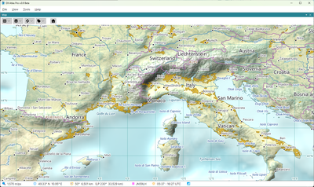</a>
      <figcaption>Alps</figcaption>
    </figure>
    <figure>
      <a href="images/gallery/nepal.png">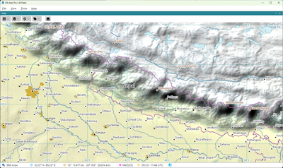</a>
      <figcaption>Nepal</figcaption>
    </figure>
    <figure>
      <a href="images/gallery/madagascar.png">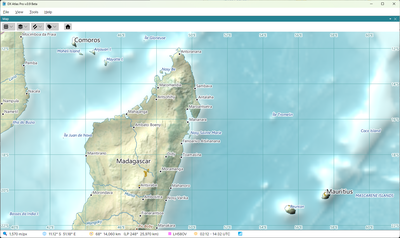</a>
      <figcaption>Madagascar</figcaption>
    </figure>
    <figure>
      <a href="images/gallery/fiji.png">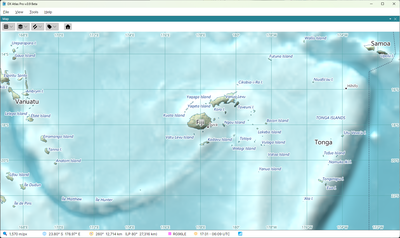</a>
      <figcaption>Fiji</figcaption>
    </figure>
    <figure>
      <a href="images/gallery/two-panels.png">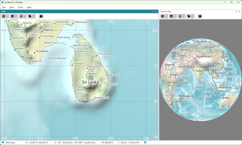</a>
      <figcaption>Two Panels</figcaption>
    </figure>
    <figure>
      <a href="images/gallery/time-zones.png">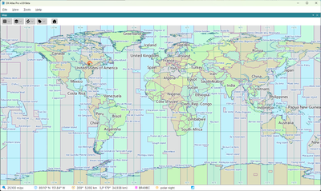</a>
      <figcaption>Time Zones</figcaption>
    </figure>
  

  

    <h2>Amateur Radio</h2>
    <figure>
      
      <figcaption>DXCC and CQ Zones</figcaption>
    </figure>
    <figure>
      <a href="images/gallery/item-details.png">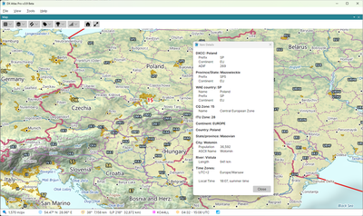</a>
      <figcaption>Item Details</figcaption>
    </figure>
    <figure>
      <a href="images/gallery/grid-squares.png">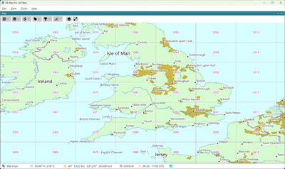</a>
      <figcaption>Grid Squares</figcaption>
    </figure>
    <figure>
      <a href="images/gallery/iota-groups.png">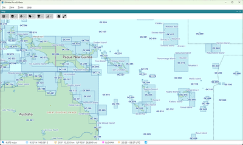</a>
      <figcaption>IOTA Groups</figcaption>
    </figure>
    <figure>
      <a href="images/gallery/f2-layer-critical-frequency.png">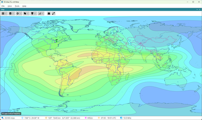</a>
      <figcaption>F2 Layer Critical Frequency</figcaption>
    </figure>
    <figure>
      <a href="images/gallery/real-time-aurora.png">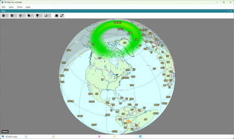</a>
      <figcaption>Real-Time Aurora</figcaption>
    </figure>
    <figure>
      <a href="images/gallery/azimuthal-projection.png">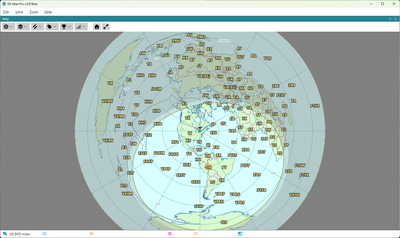</a>
      <figcaption>Azimuthal Projection</figcaption>
    </figure>
    <figure>
      <a href="images/gallery/real-time-propagation.png">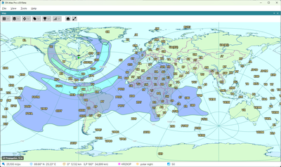</a>
      <figcaption>Real-Time Propagation</figcaption>
    </figure>
    <figure>
      <a href="images/gallery/worked-cq-zones.png">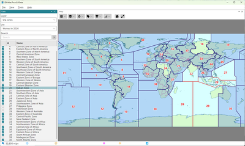</a>
      <figcaption>Worked CQ Zones</figcaption>
    </figure>
  

