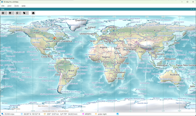
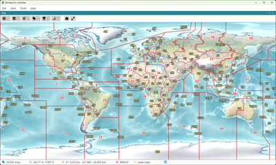

# DX Atlas Pro v.0.9 Beta

_Copyright &copy; 2026 Alex Shovkoplyas, VE3NEA_

### World Atlas

A world atlas for Windows and Linux: map projections, relief, lakes and rivers, cities,
 
layers and labels, time zones, the day and night terminator, lists and search,
 
named views and the clock

### Amateur Radio

For Radio Amateurs: prefix search, DXCC entities and prefixes, CQ and ITU zones,
 
IOTA groups, VUCC and FFMA grid squares, award tracking, Great Circle paths,
 
ionospheric maps, auroral oval and propagation prediction

## Features

See the [list of features](users_guide/overview.md#features) in the User's Guide.

## See Also

- [System Requirements](users_guide/system_requirements.md)

## Discussion Group

- [DX Atlas Pro](https://groups.google.com/g/dx-atlas-pro) at Google Groups
