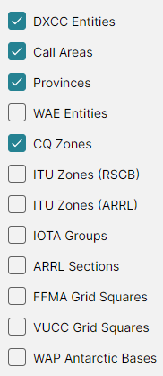

# The Amateur Radio Switch

DX Atlas Pro serves two audiences: users who want a world atlas, and Radio Amateurs. All of the
Amateur Radio functions are behind one switch, **Tools > Amateur Radio Functions**, so a user who
does not need them never meets a Ham Radio term in the menus and lists.

The program asks whether to turn the switch on when it starts for the first time; see
[Quick Start](quick_start.md). Click the menu item to turn it on or off at any time.

## What the Switch Shows

With the Amateur Radio functions on, the program adds:

- on each map toolbar, the **Amateur Radio** button, with the Amateur Radio layers, and the
  **Ionosphere** button, with the [ionospheric maps](ionospheric_maps.md), the
  [propagation map](propagation_prediction.md) and the aurora;
- on each map toolbar, the **Great Circle** button; see [Great Circle](great_circle.md);
- in the **Tools** menu, **Ionospheric Parameters...** and **Pre-compute Propagation Maps...**;
- in the **Layer** box of the [Lists Panel](lists_panel.md), the Amateur Radio layers, with their
  lists for [Award Tracking](award_tracking.md), and the [Prefix Search](prefix_search.md) on
  the DXCC layer;
- in the [Item Details](item_details.md), the DXCC entity, call area, province, zones and IOTA
  groups at the point clicked;
- in the [Colors Dialog](colors.md), the **Amateur Radio Layers** and **Amateur Radio Labels**
  sections;
- in the [Settings Dialog](settings.md), the **Propagation** section;
- an antenna in place of the house at your home location.

## The Amateur Radio Button

The **Amateur Radio** button opens the list of the Amateur Radio layers of its map:

- **DXCC Entities**, **Call Areas**, **Provinces** and **WAE Entities** - see
  [DXCC Entities and Prefixes](dxcc_entities.md);
- **CQ Zones**, **ITU Zones (RSGB)** and **ITU Zones (ARRL)** - see
  [CQ and ITU Zones](cq_itu_zones.md);
- **IOTA Groups** - see [IOTA](iota.md);
- **ARRL Sections** - see [ARRL/RAC Sections](arrl_rac_sections.md);
- **FFMA Grid Squares** - see [Other Entity Classes](other_entity_classes.md);
- **VUCC Grid Squares** - see [VUCC Grid Squares](vucc_grid.md).

## Two Sets of Checkboxes

Each map remembers its checkboxes separately for the two states of the switch. Turning the
functions off hides the Amateur Radio layers and keeps the choices you made; turning them on again
brings those choices back, and the general layers as you had them in that state. So you can keep,
say, a plain atlas with the cities on, and a Ham map with the cities off and the CQ zones on, and
switch between them with one click.

A [named view](named_views.md) saves the state of the switch too.
