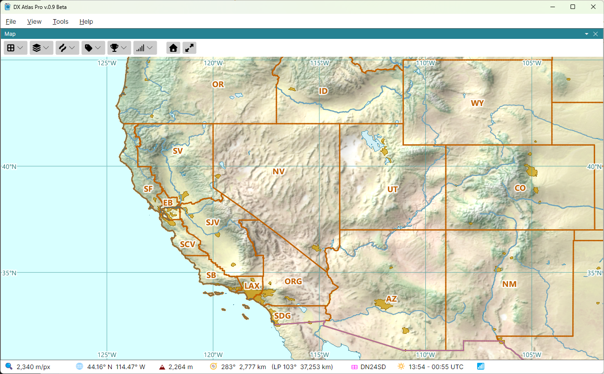

# ARRL/RAC Sections

**ARRL Sections** in the **Amateur Radio** menu draws the 85 sections of the ARRL and of Radio
Amateurs of Canada, used in the ARRL Sweepstakes, Field Day and other contests, each labelled with
its code, such as **EMA** or **ONS**. The layer is off by default.

Hover the mouse over a code to see the section's name. The [Item Details](item_details.md) of a
section list its call area.

The **ARRL/RAC sections** layer of the [Lists Panel](lists_panel.md) lists the sections by code
and name, and keeps lists of the sections worked; see [Award Tracking](award_tracking.md).
