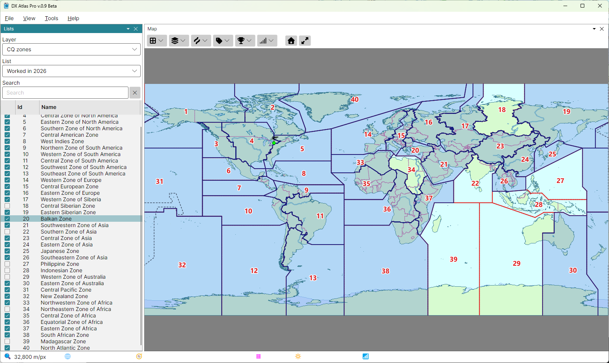

# Award Tracking

The lists of the [Lists Panel](lists_panel.md) track your progress towards awards: a list is a
named set of the items of one layer - DXCC entities, CQ zones, IOTA groups - that you tick as you
work or confirm them, and the map paints the items of the list selected.

## Award Layers

These layers keep lists:

- **DXCC entities**, **WAE countries** and **WAS**;
- **CQ zones**, **ITU zones (RSGB)** and **ITU zones (ARRL)**;
- **IOTA groups**, **ARRL/RAC sections** and **FFMA grid squares**;
- your own layers; see [Create a Custom Layer](create_custom_layer.md).

## Creating Lists

Create one list for each record you keep. A list holds one flag per item, so worked and confirmed
are separate lists, as are bands and modes: "Worked", "Confirmed", "160 m", "CW", or
"160 m confirmed".

1. pick the layer in the **Layer** box;
2. in the **List** box, pick **New List...** and type the list's name;
3. tick the checkbox of each item you have; type in the **Search** box to find an item quickly. On
   the DXCC layer, typing the callsign of a station you worked finds its entity; see
   [Prefix Search](prefix_search.md).

The lists are saved as soon as a checkbox changes, in the file `Lists.json` in the user data
folder, with a backup copy, `Lists.json.bak`, beside it. **Help > Data Folder...** opens that
folder.

## Award Colouring

While a list is selected, both maps paint its items over the regular map:

- an item with an area - an entity, a zone, an IOTA group's rectangle - is filled semi-transparent
  and outlined;
- an area too small to see at the current zoom, such as the Vatican, is drawn as a circle too, so
  it still shows at a world view.

Ticking or clearing a checkbox paints or clears its item at once. With **&lt;none&gt;** selected,
or while the Lists panel is closed, nothing is painted. The items of your own layers are not
painted.

The fill and the outline colours are **Award Coloring** in the **Amateur Radio Layers** section of
the [Colors Dialog](colors.md).

## Deleting a List

Pick **Delete List...** in the List box and confirm it. The list and its ticks are deleted.
