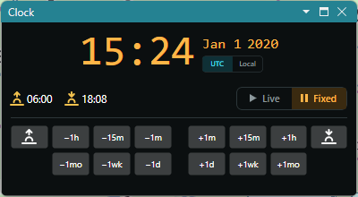

# Clock and Fixed Time

The **Clock** panel shows the time and the date, and the sunrise and sunset at your home location.
It also sets the time the maps are drawn for: the computer's time, or a fixed time of your choice.
The panel is hidden when the program starts for the first time; show it with **View > Clock**.

## UTC and Local Time

The **UTC** and **Local** switch selects the time zone the panel shows: UTC, or the time zone of
the computer. The sunrise and sunset in the [Status Bar](status_bar.md) follow the same
switch.

## Live and Fixed Time

The **Live** and **Fixed** switch selects the time:

- **Live** - the panel follows the computer's clock, and the time is shown in green;
- **Fixed** - the clock stops at the current time, which is shown in amber, and the panel shows the
  buttons to change it.

While the time is fixed, everything that depends on the time follows the panel instead of the
computer's clock: the gray line, the local times in the [Item Details](item_details.md), the
sunrise and sunset in the [Status Bar](status_bar.md), and, with the Amateur Radio functions on,
the ionospheric maps and the aurora. You can see the gray line of any day of the year, or the local
time anywhere at any moment.

### Changing a Fixed Time

- the time buttons step the time by **1 hour**, **15 minutes** or **1 minute**, back and forward;
- the date buttons step the date by **1 month**, **1 week** or **1 day**, back and forward;
- right-click the time or the date and pick **Set Date...** to pick a day in a calendar. The time
  of day is kept. Picking a date while the clock is live fixes it.

### Sunrise and Sunset Locks

The two buttons at the ends of the time row lock the time to the day's sunrise or sunset at your
home location. While a lock is on, stepping the date keeps the time at sunrise or sunset of the new
day, so you can follow the gray line at your sunrise through the seasons. Click the button again to
release the lock.

## Returning to the Computer's Time

Click **Live**. Closing the Clock panel also returns to the computer's time, so the maps never
stay at a fixed time you cannot see.

## The Panel's Shape

The panel arranges itself to the room it has: a box, a narrow column, or, docked wide and short
across the window, a strip. Its digits grow and shrink with it.
