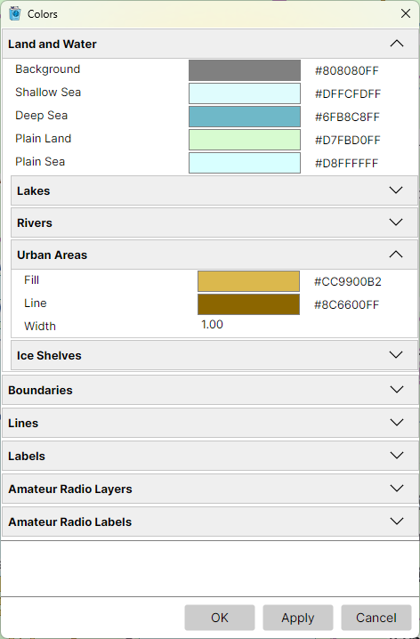
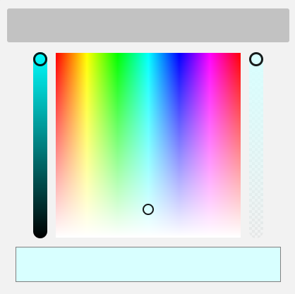

# Colors Dialog

**Tools > Colors** opens the Colors dialog, which sets the colours, line widths and label faces of
everything drawn on the map. It works as the [Settings Dialog](settings.md) does: sections that
fold open, **Reset** on a right-click of a field's name, and **OK**, **Apply** and **Cancel**.
**Apply** redraws both maps in the new colours while the dialog stays open, so you can try a colour
before you keep it.

Each colour has an opacity as well, so a fill can let the relief show through it.

## Picking a Colour

Each colour field shows a swatch of the colour and its value, `#RRGGBBAA` - red, green, blue and
opacity in hexadecimal. Right-click the value and pick **Copy** to copy it to the clipboard.

Click the swatch to open the colour picker:

- **the large square** - the hue from left to right, and the saturation from top to bottom, full
  colour at the top fading to white at the bottom. Click or drag in it to pick a colour;
- **the slider on the left** - the brightness, from black at the bottom to full brightness at the
  top;
- **the slider on the right** - the opacity, from fully transparent at the bottom, where the
  checkerboard shows through, to opaque at the top;
- **the bar at the bottom** - the colour picked so far.

The field takes the new colour as you pick it. Click outside the picker or press **Esc** to close
it, then **Apply** or **OK** to redraw the maps in it.

## Sections

- **Land and Water** - the background, the shallow and the deep sea, the plain land that replaces
  the relief when **Land Relief** is off and the plain sea that replaces the ocean depth when
  **Ocean Relief** is off, the lakes, rivers, urban areas and ice shelves;
- **Boundaries** - the coastline; the borders, which strengthen and widen as the map zooms in; the
  four fills of the time zones and their boundaries; the date line;
- **Lines** - the graticule, the azimuth and distance lines, the gray line's shadows and
  terminator, and the highlight of an item found from the [Lists Panel](lists_panel.md);
- **Labels** - each kind of label: countries, big and small cities, island groups, islands,
  oceans, seas, lakes, rivers, mountain ranges, summits, regions, ice shelves and the graticule's
  degrees. Each has a colour, a halo colour around the letters, a size, and bold and italic.

With the Amateur Radio functions on, two more sections set the colours of the Amateur Radio
layers and labels; see [The Amateur Radio Switch](amateur_radio_switch.md).

The colours are saved in a file of their own, `Colors.json`, in the user data folder.
