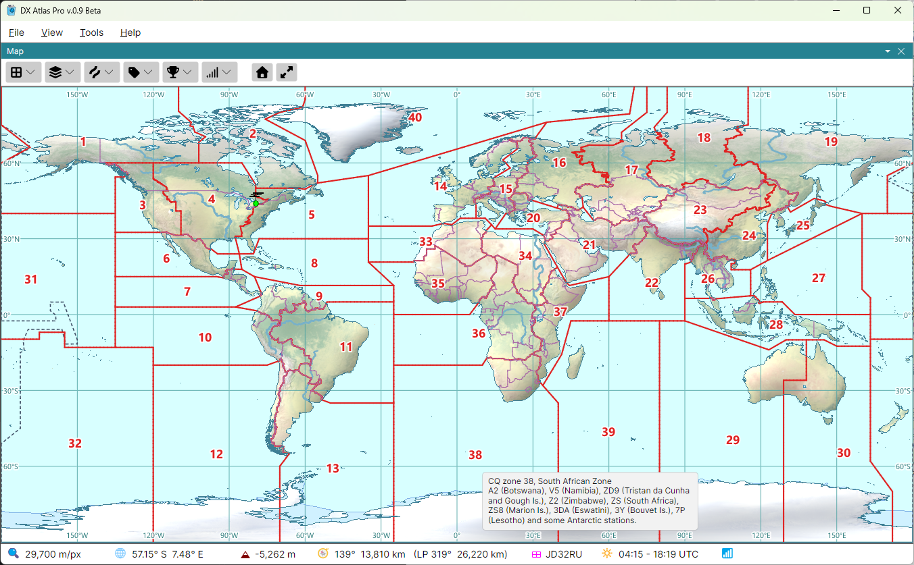

# CQ and ITU Zones

The **Amateur Radio** button has three zone layers:

- **CQ Zones** - the 40 zones of CQ magazine's WAZ award and the CQ contests;
- **ITU Zones (RSGB)** - the 75 ITU zones as the RSGB defines them for its WITUZ award;
- **ITU Zones (ARRL)** - the 75 ITU zones as the ARRL defines them for the IARU HF Championship.

The two societies draw some ITU zone boundaries differently, so the program has both versions.
Each zone set is drawn as filled and outlined areas, each zone labelled with its number. The
layers are off by default, but for the CQ zones on the first map.

## Tooltips and Details

Hover the mouse over a zone number to see the zone's definition: the prefixes and areas it
covers, such as *C3 (Andorra), CT (Portugal), CU (Azores), ...* for CQ zone 14.

The [Item Details](item_details.md) of a point always list its CQ zone and its ITU zone, and,
where the ARRL's ITU zone differs from the RSGB's, both. A point at sea in no ITU zone is listed as
**none**.

## In the Lists Panel

The **CQ zones**, **ITU zones (RSGB)** and **ITU zones (ARRL)** layers of the
[Lists Panel](lists_panel.md) list the zones by number and name, and keep lists of zones worked or
confirmed; see [Award Tracking](award_tracking.md).

The colours of the zones and of their numbers are set in the **Amateur Radio Layers** and
**Amateur Radio Labels** sections of the [Colors Dialog](colors.md).
