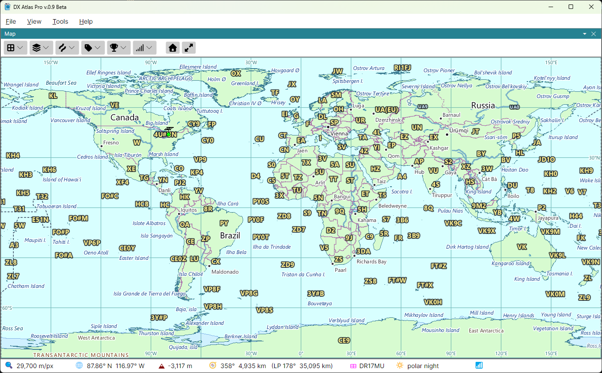

# DXCC Entities and Prefixes

## On the Map

The first four checkboxes of the **Amateur Radio** button draw the DXCC entities and their
subdivisions. Each one switches a set of boundaries and its prefix labels together:

- **DXCC Entities** - the borders of all 340 current DXCC entities, and their prefixes. The
  borders between countries that are also DXCC entities are drawn by **Political Boundaries** in
  the [Lines](layers_lines_labels.md) menu as well, so the two can be shown separately;
- **Call Areas** - the call areas of the larger entities, such as W4 or VE3, and their prefixes;
- **Provinces** - the provinces, states and oblasts that have prefixes of their own, and their
  prefixes. Call Areas and Provinces are available only while DXCC Entities is on;
- **WAE Entities** - the countries of the DARC's Worked All Europe list, such as the Shetland
  Islands (GM/s) or Sicily (IT9), and their prefixes. While it is on, the WAE borders replace the
  DXCC, call area and province boundaries, so WAE Entities and DXCC Entities are never on together:
  ticking one clears the other.

Hover the mouse over a prefix to see the name of its entity, province or call area; for a call
area, its definition. Click a prefix to see its [Item Details](item_details.md): the prefix, the CQ
and ITU zones, the continent, the ADIF number and the local time.

## In the Lists Panel

The **DXCC entities** layer of the [Lists Panel](lists_panel.md) lists the entities as a tree: each
DXCC entity, the call areas under it, and the provinces under them, as the prefixes are
structured. The **Prefix** column shows each one's prefix, and the triangle before it opens and
closes its rows. Type a callsign in the Search box to find its entity; see
[Prefix Search](prefix_search.md).

With a list selected, only the DXCC entities have checkboxes: a DXCC list is a list of entities,
and the call areas and provinces under them are there to be looked up. See
[Award Tracking](award_tracking.md).

The **WAE countries** layer lists the WAE countries by their prefixes, and the **WAS** layer the 50
US states, Alaska and Hawaii among them, for the Worked All States award.

*DXCC is a trademark of the ARRL; the DXCC entity list is reprinted with the permission of the
ARRL. For the DXCC programme and its rules, see [www.arrl.org/dxcc](https://www.arrl.org/dxcc).*
