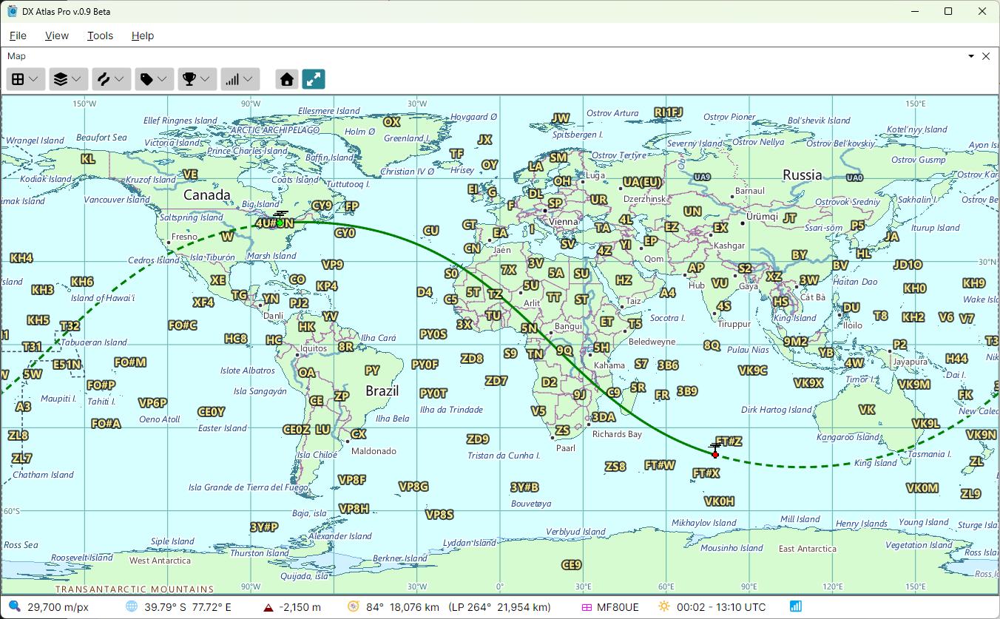

# Great Circle

The **Great Circle** button on the map toolbar, right of the **Home** button, draws the path of a
signal from your station. Click it to keep it down: while it is down, the map draws the great
circle from your [home location](home_location.md) to the point under the mouse, the shortest path
between them on the globe. Click it again to stop drawing.

To see the path between two other points, press the left mouse button on the first point and drag
the mouse to the second: while the button is held, the map draws the great circle, short path and
long path, between these points, and the [Status Bar](status_bar.md) shows the bearing and the distance along
this path, from the point where you pressed the button. When you release the button, the great
circle from your home location returns. While the **Great Circle**
button is down, dragging the mouse draws this path instead of moving the map; use the mouse wheel to
zoom, or click the button again to drag the map.

The bearing and the distance along the great circle, by the short and the long path, are shown in
the [Status Bar](status_bar.md): the bearing to turn the beam to, and, after **LP**, the opposite
bearing and the distance the other way around the Earth.

With the Amateur Radio functions on, the home location is marked with an antenna in place of the
house.
