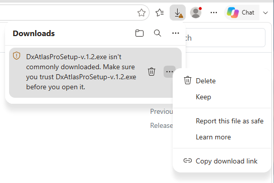
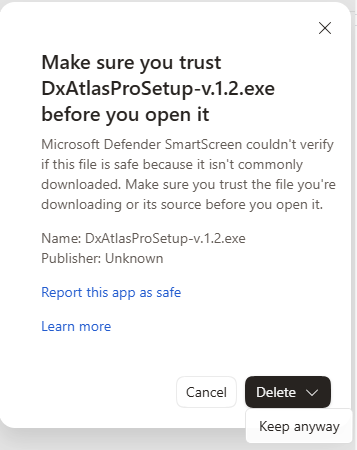

# Installation

Download the setup program for Windows, or the archive for Linux, from the
[Download](https://ve3nea.github.io/DxAtlasPro/download.html) page. Check the [System Requirements](system_requirements.md) first.

## Windows

1. Run `DxAtlasProSetup-v.X.Y.exe`, where X.Y is the version number. The setup needs administrator
   rights, and Windows asks for them when it starts;
2. accept the Licence Agreement;
3. if the .NET 10 Runtime or the Microsoft Visual C++ Redistributable is not on the computer, the
   setup downloads and installs it;
4. optionally, tick **Create a desktop shortcut**;
5. when the setup finishes, leave **Launch DX Atlas Pro** ticked to start the program.

The program is installed in `C:\Program Files\Afreet\DxAtlasPro`, with a shortcut in the Start
menu. The setup also registers the COM interface that lets programs written for DX Atlas 2 work
with DX Atlas Pro; see the [Developer's Guide](https://ve3nea.github.io/DxAtlasPro/developers_guide/overview.html).

To install a new version, run its setup over the old one. Your settings are kept.

### If Windows blocks the setup

The setup program is not code-signed, so Windows warns about it as it warns about any new
program from a small developer:

- **Edge says the file "isn't commonly downloaded"** - in the Downloads list, click **...**
  beside the file, then **Keep**:

  

  Edge then asks you to make sure you trust the file. Click the arrow on the **Delete** button
  and choose **Keep anyway**:

  

- **"Windows protected your PC"** when you run the setup - click **More info**, then
  **Run anyway**;
- **the setup does not start at all** - right-click the downloaded file in File Explorer,
  choose **Properties**, tick **Unblock** at the bottom of the **General** tab, click **OK**, and
  run the setup again.

**Smart App Control**, where it is on, blocks unsigned programs, and none of the steps above get
past it. You can see whether it is on in **Windows Security > App & browser control > Smart App
Control settings**.

### Uninstalling

Uninstall DX Atlas Pro from **Settings > Apps > Installed apps** in Windows. Your settings are
not removed; they stay in `%APPDATA%\Afreet\Products\DxAtlasPro`, and you can delete that folder
by hand.

If DX Atlas is also installed on the computer, uninstalling DX Atlas Pro removes the COM
registration that the two programs share, so reinstall DX Atlas afterwards for the programs that
use its COM interface.

## Linux

The Linux version is a self-contained archive: it needs no installation and no .NET Runtime.

1. Unpack the archive to any folder, for example your home folder; it creates a `DxAtlasPro`
   folder there, so do not create one yourself:

   ```bash
   tar -xzf ~/Downloads/DxAtlasPro-v.X.Y-linux-x64.tar.gz -C ~
   ```

   Replace X.Y with the version number, and `~/Downloads` with the folder you downloaded the
   archive into if your browser saved it elsewhere;

2. run the program:

   ```bash
   ~/DxAtlasPro/DxAtlasPro
   ```

To install a new version, first delete the old `DxAtlasPro` folder, then unpack the new archive
as in step 1:

```bash
rm -rf ~/DxAtlasPro
```

Your settings are not in that folder, so they are kept: they are in
`~/.config/Afreet/Products/DxAtlasPro`. To uninstall, delete the program folder and, if you
do not need your settings any more, that folder too.
