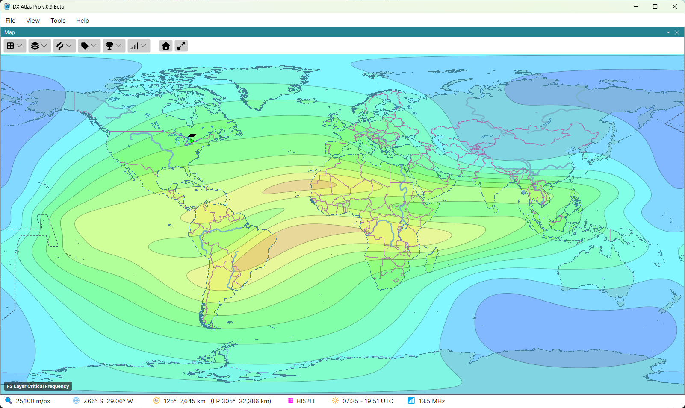
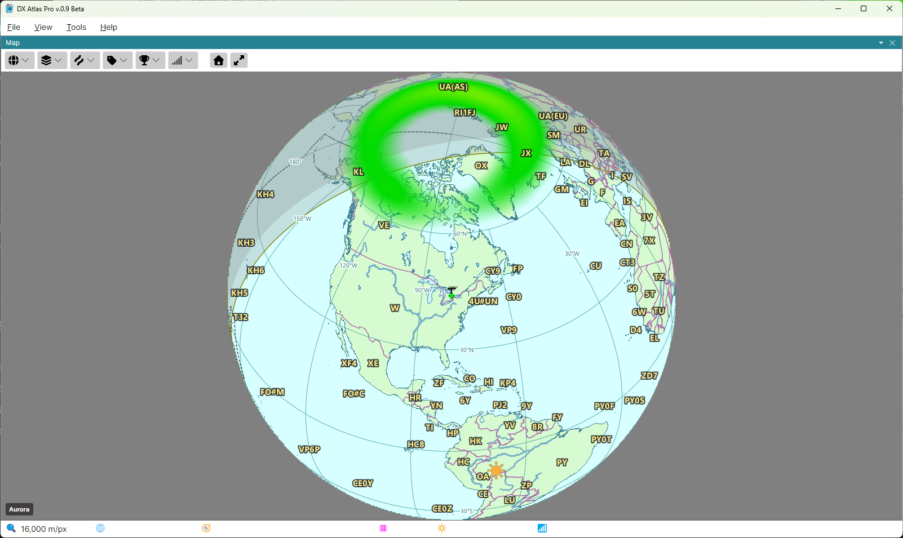
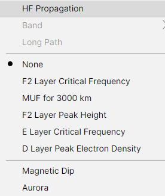
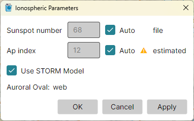

# Ionospheric Maps

The **Ionosphere** button on the map toolbar, shown with the Amateur Radio functions on, draws
maps of the ionosphere over the world map. The maps are computed by the program with the IRI-2026
model of the International Reference Ionosphere, for the moment the [Clock](clock.md) panel shows:
the current time, or a fixed time in the past or the future. What each map tells a DXer is
explained in [Reading the Maps for DX'ing](reading_the_maps.md).

## The Ionosphere Button

- **HF Propagation**, **Band** and **Long Path** - the propagation map; see
  [Propagation Prediction](propagation_prediction.md);
- **None**, or one of the ionospheric maps:
  - **F2 Layer Critical Frequency** - foF2, the highest frequency the F2 layer reflects straight
    up, in MHz; see [foF2 and MUF(3000)](reading_the_maps.md#fof2-and-muf3000);
  - **MUF for 3000 km** - MUF(3000), the highest frequency that one 3000 km hop through the F2
    layer supports, in MHz, banded at the amateur bands; see
    [foF2 and MUF(3000)](reading_the_maps.md#fof2-and-muf3000);
  - **F2 Layer Peak Height** - hmF2, the height of the F2 layer's peak, in km; see
    [hmF2](reading_the_maps.md#hmf2);
  - **E Layer Critical Frequency** - foE, in MHz; see [foE](reading_the_maps.md#foe);
  - **D Layer Peak Electron Density** - NmD, in units of 10⁸ electrons per cubic metre; see
    [NmD](reading_the_maps.md#nmd);
- **Magnetic Dip** - the dip equator and the lines of 20° and 40° magnetic dip on either side of it,
  with dashed lines 2000 km beyond the 40° lines; see
  [Magnetic Dip](reading_the_maps.md#magnetic-dip);
- **Aurora** - the auroral oval, the probability of visible aurora, from the NOAA Space Weather
  Prediction Center's OVATION model; see [The Aurora Oval](reading_the_maps.md#the-aurora-oval).

The maps between the separators exclude one another, and exclude HF Propagation too: picking one
replaces the map shown. **Magnetic Dip** and **Aurora** are checkboxes of their own, drawn alone or
over any map. Each map panel has its own choice, so the two maps can show different maps.

## Reading a Map

Each map is drawn in bands of colour, with the legend in the lower left corner of the map: its
name and its unit. The status bar's 📶 cell shows the
value at the point under the mouse - `7.2 MHz`, `312 km`, and with Magnetic Dip and Aurora on,
`dip 23°` and `aurora 15%` after it. While a map is being computed, the cell shows `…`.

## The Ionospheric Parameters Dialog

**Tools > Ionospheric Parameters...** shows the solar and geomagnetic indices the maps are computed
from, and where each one came from:

- **Sunspot number** - the smoothed sunspot number of the map's month;
- **Ap index** - the geomagnetic activity index;
- **Use STORM Model** - corrects foF2 for geomagnetic storms, from the recent history of the Ap
  index, on the ionospheric and the propagation maps. It is disabled while there is no Ap data;
- **Auroral Oval** - the state of the aurora data.

With **Auto** ticked, a box shows the value the maps use. Clear **Auto** to enter a value of your
own, then click **Apply** to see the maps with it - what the bands would look like at a sunspot
number of 200, say. The values entered last until the program closes; on the next start, both rows
return to Auto.

### Where the Values Come From

After each value, one word says where it came from; hover over it for the date:

- **file** - the index file installed with the program, until a download arrives;
- **web** - downloaded;
- **user** - entered by you;
- **estimated** - the map's date is past the end of the data, so the last value is used: the
  sunspot number at any date, the Ap index only within 9 hours of the last value;
- **not fetched** - the aurora, while no map shows it; it is downloaded only then;
- **no data** - nothing to use. With no Ap data the storm model is skipped; with no aurora data
  no aurora is drawn.

An amber **⚠** before the word means a download failed and older data is used; hover over it for
the error and the time of the next attempt. The **⟳** button after the word retries the download
at once. A red **✕** means there is no data at all.

### The Downloads

The program downloads the indices by itself, and only while a map that uses them is shown:

- the Ap index from the GFZ Helmholtz Centre for Geosciences, every 3 hours, as each new value is
  published;
- the sunspot numbers from irimodel.org, once a month;
- the aurora from the NOAA Space Weather Prediction Center, every 15 minutes while a map shows it.

Without an Internet connection, the maps are computed from the index files installed with the
program, and from the last downloaded data.

*The real-time aurora, the Ap index and the sunspot numbers are available only as long as the NOAA
Space Weather Prediction Center, the GFZ Helmholtz Centre for Geosciences and irimodel.org provide
them on the web. If a source stops publishing its data or changes its format, the maps that use it
fall back to the data already downloaded or installed with the program.*
