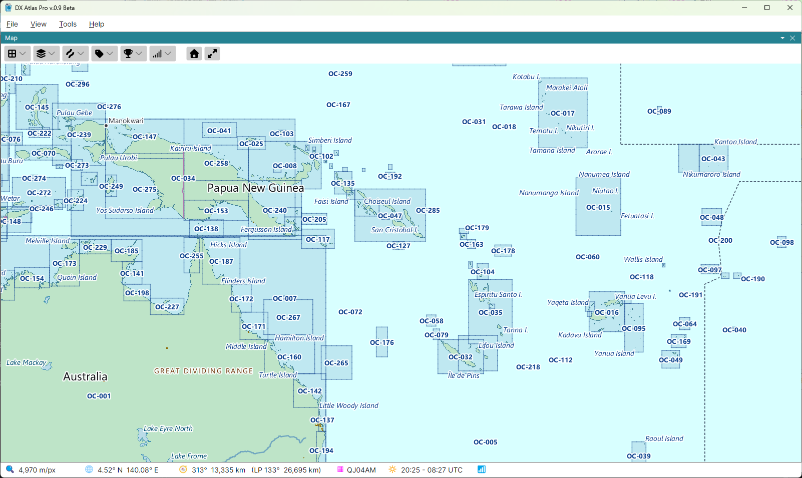

# IOTA

**IOTA Groups** in the **Amateur Radio** menu draws the 1,178 island groups of the Islands on the
Air programme, each as the rectangle that bounds its islands, labelled with its reference, such as
AF-001. The layer is off by default.

Hover the mouse over a reference to see the group's name. The rectangles of neighbouring groups
overlap, so the [Item Details](item_details.md) of a point list every IOTA group whose rectangle
holds it.

The **IOTA groups** layer of the [Lists Panel](lists_panel.md) lists the groups by reference and
name, and keeps lists of the groups worked or confirmed; see [Award Tracking](award_tracking.md).

*The IOTA groups and their rectangles are used with the permission of the IOTA Committee. For the
programme and its rules, see [www.rsgbiota.org](https://www.rsgbiota.org/).*
