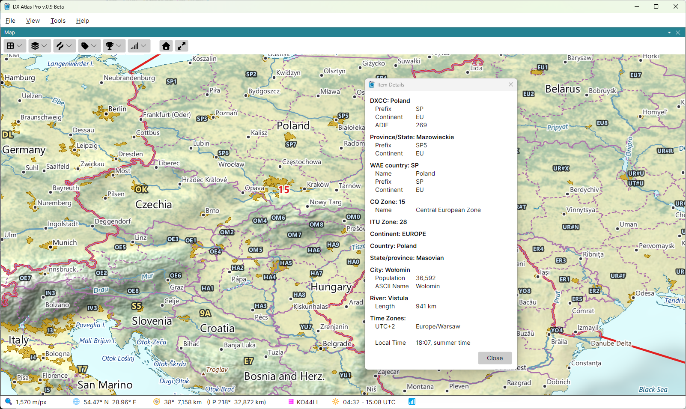

# Item Details

The **Item Details** window lists what is at a point of the map: the country, the state or
province, the city, island, sea or lake, and, with the Amateur Radio functions on, the DXCC entity,
its call area and province, and the zones, each with its attributes. The time zones and the local
time at the point come last.

## Opening the Window

- **Ctrl-click the map** to list everything at the point clicked;
- **click a label** to list the item the label names, as if you clicked its place on the map;
- **right-click the map** and pick **Show Details for ...**: the menu item names the label under
  the mouse, or says **Point** where there is no label;
- in the [Lists Panel](lists_panel.md), **Ctrl-click a row**, or right-click it and pick
  **Show Details**, to list that row's item. A province or call area is listed with its DXCC entity
  above it.

The keys of the Ctrl-click can be changed in the **Mouse Clicks** section of the
[Settings Dialog](settings.md).

## What the Window Shows

Each item has a heading - its type and name, such as **Country: Japan** - and its attributes
indented under it. The attributes depend on the item: an island lists its area, a city its
population, a DXCC entity its prefix, zones, continent and ADIF number. A detail that another item
already gives is not repeated: the zones are listed once, under their own headings.

The local time is given for the moment the [Clock](clock.md) panel shows, with summer time taken
into account, so with a fixed time on the clock you can see the local time anywhere at any moment
since 1945.

The position, grid square, bearing, distance and sunrise and sunset of the point are not listed:
the [Status Bar](status_bar.md) shows them as you move the mouse.

## Closing the Window

The window stays open, and each new click fills it again. To close it, click its **Close** button,
press **Escape**, or click anywhere in the main window; that click does nothing else.
