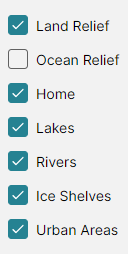
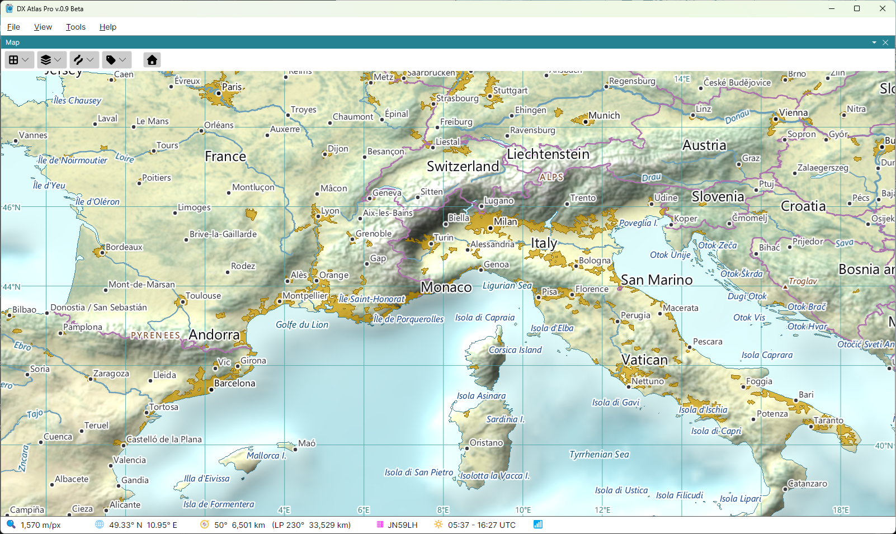
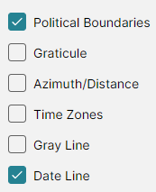
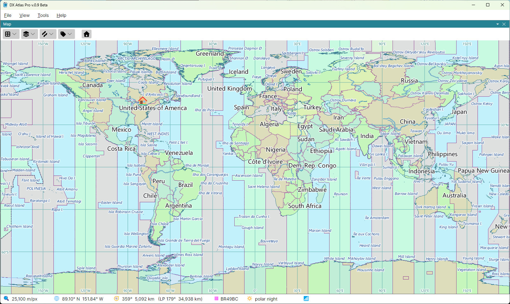
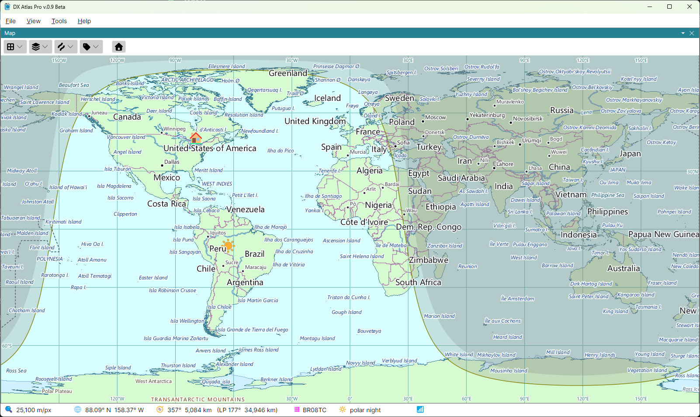
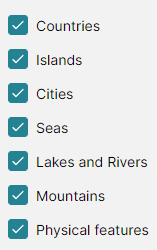

# Layers, Lines and Labels

Three buttons on the map toolbar choose what the map shows: **Layers**, **Lines** and **Labels**.
Each opens a list of checkboxes; tick a checkbox to show its layer, clear it to hide the layer. The
choices are made for each map separately, and saved when the program closes.

The Amateur Radio layers - DXCC entities, zones, IOTA groups and the rest - are in a fourth
button's menu, shown only with the Amateur Radio functions on; see
[The Amateur Radio Switch](amateur_radio_switch.md).

## Layers

- **Land Relief** - the shaded relief and land cover of the land. Cleared, the land is one flat
  colour;
- **Ocean Relief** - the depth and the shaded relief of the sea floor. Cleared, the sea is one flat
  colour. Clear both to read boundary lines against a plain map; the two flat colours are set in
  the [Colors Dialog](colors.md);
- **Home** - the mark of your home location, a house, or an antenna with the Amateur Radio
  functions on;
- **Lakes**, **Rivers**, **Ice Shelves** and **Urban Areas**.

## Lines

- **Political Boundaries** - the borders between countries;
- **Graticule** - the lines of latitude and longitude, labelled with their degrees;
- **Azimuth/Distance** - great circles radiating from your home location, and circles of equal
  distance around it, labelled with their bearings and distances. The distance circles are drawn
  every 3000 km, the length of an F2 hop. On the azimuthal map they radiate from the centre of the
  map;
- **Time Zones** - the time zones, filled in alternating colours;
- **Gray Line** - the day and night terminator and the night shadow, with the sun at the point
  where it is overhead;
- **Date Line** - the international date line.

The coastline has no checkbox: it is always drawn.

### The Gray Line

The gray line follows the sun as the time goes by, at the time the [Clock](clock.md) panel shows:
the computer's time, or a fixed time of your choice. Which of its parts are drawn - the sun, the
terminator, the twilight shadow and the night shadow - where the night shadow begins, and how
often it is redrawn are set in the **Map** section of the [Settings Dialog](settings.md).

## Labels

- **Countries**;
- **Islands** - islands and island groups;
- **Cities**;
- **Seas** - oceans, seas, gulfs, bays and ice shelves;
- **Lakes and Rivers**;
- **Mountains** - mountain ranges and summits;
- **Physical features** - deserts, plateaus, peninsulas, capes and other regions.

The labels are placed so that they never overlap. At a world view only the largest features are
labelled, and more labels appear as you zoom in.

### Tooltips

Hover the mouse over a label to see its tooltip: the full name of the item, or, for the Amateur
Radio labels, the name of a DXCC entity or province, or the definition of a zone or a call area.
Click a label to see the [Item Details](item_details.md) of the item it names.

## Colours

The colours and line widths of all layers, and the colours, sizes and fonts of all labels, are set
in the [Colors Dialog](colors.md).
