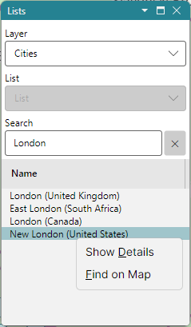

# The Lists Panel

The **Lists** panel shows the items of a map layer - countries, cities, islands, rivers and the
rest - as a list that you can search and sort, and links that list to the maps: pick a row to find
its item on the map, or pick an item on the map to find its row.

The panel has three boxes at the top and the list of items under them.

## Layer

The **Layer** box selects the layer the list shows:

- the layers of the atlas, named and grouped as in the **Labels** menu of the map, so that every
  name on the map is a row of one of them, and every row a name on the map:
  - **Countries**;
  - **Islands** - islands and island groups;
  - **Cities**;
  - **Seas** - oceans, seas, gulfs, bays, straits and ice shelves;
  - **Lakes and Rivers**;
  - **Mountains** - mountain ranges and summits;
  - **Physical features** - deserts, plateaus, peninsulas, coasts and other regions.

  Cities and islands have their country in brackets after the name, so that the many cities named
  Paris can be told apart;
- your own layers, read from files; see [Create a Custom Layer](create_custom_layer.md);
- **Pins**; see [Pins](pins.md).

With the Amateur Radio functions on, the Layer box also lists the Amateur Radio layers, first; see
[Prefix Search](prefix_search.md) and [Award Tracking](award_tracking.md).

The layer selected is saved when the program closes.

## List

Some layers keep **lists**: named sets of the layer's items that you create. With a list selected,
each row has a checkbox, ticked when its item is in the list; tick or clear it to add or remove the
item. The lists are saved as soon as they change.

The List box holds:

- **&lt;none&gt;** - no list selected, and no checkboxes;
- the lists of the layer, by name;
- **New List...** - prompts for a name and creates an empty list;
- **Delete List...** - deletes the selected list, once you confirm it.

The layers of the atlas - cities, countries, rivers and the rest - are for looking items up and
have no lists, so their List box is disabled. Your own layers and the Pins layer have lists, and so
do the Amateur Radio layers, on which the lists track awards. The format of the files that your own
layers are read from is described in [Create a Custom Layer](create_custom_layer.md).

## Search

Type a name in the **Search** box and the list shows only the items whose names match. Every word
typed must match the start of a word of the name: `new y` finds New York. The ✕ button right of
the box clears it.

By default a name matches by its letters, ignoring case. In the **Lists** section of the
[Settings Dialog](settings.md), **Name Search** can be set to match names by their sound instead,
so that a misspelt name still finds its item: *Gray* finds *Grey*.

## The List of Items

The list shows the items' names, and for the layers whose items have a readable id, such as a zone
number, a second column with the id. On a layer that holds items of several types, such as
**Mountains** or **Seas**, the second column is **Type** instead: Range, Mountain, Gulf, Strait and
so on. Click a column header to sort by that column; click it again to reverse the order.

Hover the mouse over a name to see its tooltip.

### From a Row to the Map

**Double-click a row**, or right-click it and pick **Find on Map**, to find its item: the item is
highlighted on both maps with a yellow outline, or with a ring at its point, and the map you last
used is centred on it and zoomed so that the item spans about half of the map.

**Ctrl-click a row**, or right-click it and pick **Show Details**, to see its
[Item Details](item_details.md).

### From the Map to a Row

Right-click an item on the map and pick **Find in List**: its row is selected and scrolled into
view, its layer is made current if it is not, and the item is highlighted on both maps. The map is
not moved.

A click on the map clears the highlight.

The keys of these clicks can be changed in the **Mouse Clicks** section of the Settings dialog. The
**Find in List / on Map** action has no keys by default; give it keys there to find a row's item, or
a map item's row, with a single click.

## Hiding the Panel

While the Lists panel is hidden, the maps show no highlight, no pins and no award colouring.
