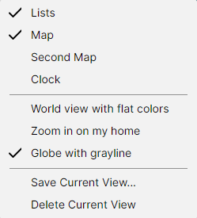

# Named Views

A named view saves the state of the whole program under a name, so you can return to it with one
click: a "Europe" view for one task and a "World, two maps" view for another. A view holds:

- whether the Amateur Radio functions are on;
- which panels are shown, and the window layout;
- for each map shown: its projection, its centre and zoom, and every checkbox of its Layers, Lines,
  Labels, Amateur Radio and Ionosphere menus.

## Saving a View

Set the program up as you want it, then pick **View > Save Current View...** and type a name. Each
view must have a name of its own.

## Switching Views

The saved views are listed in the **View** menu, below the panel checkboxes. Pick one to restore
it. The view you picked last is ticked in the menu for as long as the program still shows it
unchanged; a pan, a zoom or a changed checkbox clears the tick. The sizes and positions of the
panels are not compared.

## Deleting a View

Pick the view to make it current, then **View > Delete Current View**. The item is disabled while
no view is ticked.
