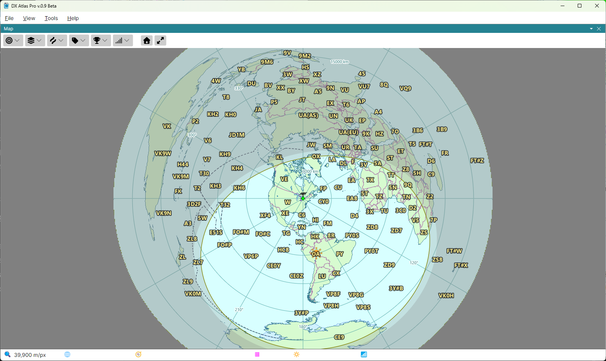
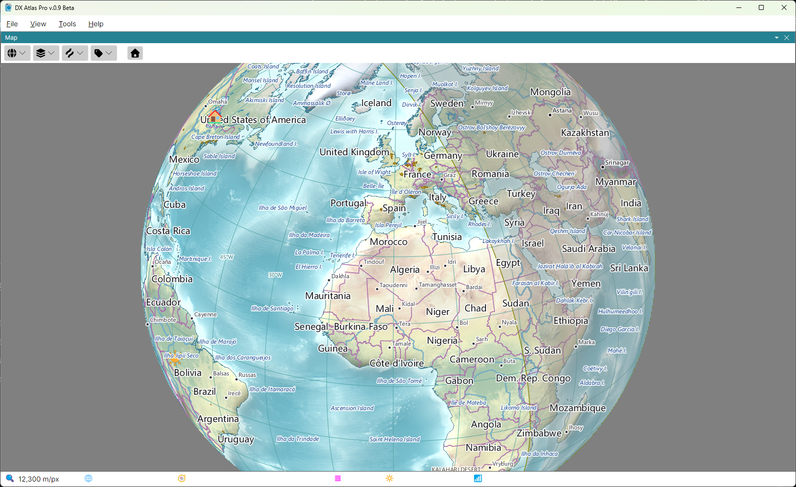

# Projections, Zoom and Pan

Each of the two map panels has a toolbar above the map:

- **Projection** - the projection of this map;
- **Layers**, **Lines** and **Labels** - what the map shows; see
  [Layers, Lines and Labels](layers_lines_labels.md);
- **Amateur Radio** and **Ionosphere** - shown only with the Amateur Radio functions on; see
  [The Amateur Radio Switch](amateur_radio_switch.md);
- **Home** - see [Home Location](home_location.md).

The two maps are independent: each has its own projection, centre, zoom and layers.

## Projections

Click the **Projection** button and pick one of the three projections. The button shows the
glyph of the current one.

- **Rectangular** - the whole world in one rectangle, latitude and longitude as straight lines;
- **Azimuthal** - the azimuthal equidistant projection, centred on one point: every straight line
  through the centre is a great circle, and the distance and the bearing from the centre to any
  point are true. When you switch to it, the map is centred on your home location;
- **Globe** - the Earth as seen from space.

## Zoom

Turn the mouse wheel over the map to zoom in and out; three steps of the wheel double or halve the
magnification. On the rectangular map the zoom keeps the point under the mouse in place, so the
wheel takes you to a place as well as closer to it. The azimuthal map and the globe zoom about
their centre, which stays where it is.

The status bar shows the scale of the map under the mouse, in metres or feet per pixel, as set in
the **Units** section of the [Settings Dialog](settings.md).

## Pan

- **Rectangular map** - drag the map with the left mouse button;
- **Globe** - drag the globe to turn it;
- **Azimuthal map** - its centre is chosen, not dragged, since every distance and bearing on it is
  measured from the centre. Shift-click a point to make it the centre, or right-click it and pick
  **Set as Center**. Ctrl+Shift-click a point, or pick **Set Antipode as Center**, to centre the map
  on the point opposite it on the globe.

The **Home** button on the toolbar shows the whole world on the rectangular map, and centres the
azimuthal map and the globe on your home location.

## Linking the Two Maps

Alt-click a point on one map, or right-click it and pick **Center Other Map Here**, to centre the
other map on that point; the other map keeps its projection and zoom. This works while both maps
are shown.

The keys held with each click can be changed in the **Mouse Clicks** section of the
[Settings Dialog](settings.md).

## The Map's Context Menu

Right-click the map for a menu of what can be done at that point:

- **Show Details for ...** - the [Item Details](item_details.md) of the label under the mouse, or
  of everything at the point;
- **Find in List** - select the item under the mouse in the [Lists Panel](lists_panel.md);
- **Set as Center** and **Set Antipode as Center** - on the azimuthal map only;
- **Center Other Map Here**;
- **Set Home Location Here** - see [Home Location](home_location.md);
- **Add Pin** and **Remove Pin** - see [Pins](pins.md).
