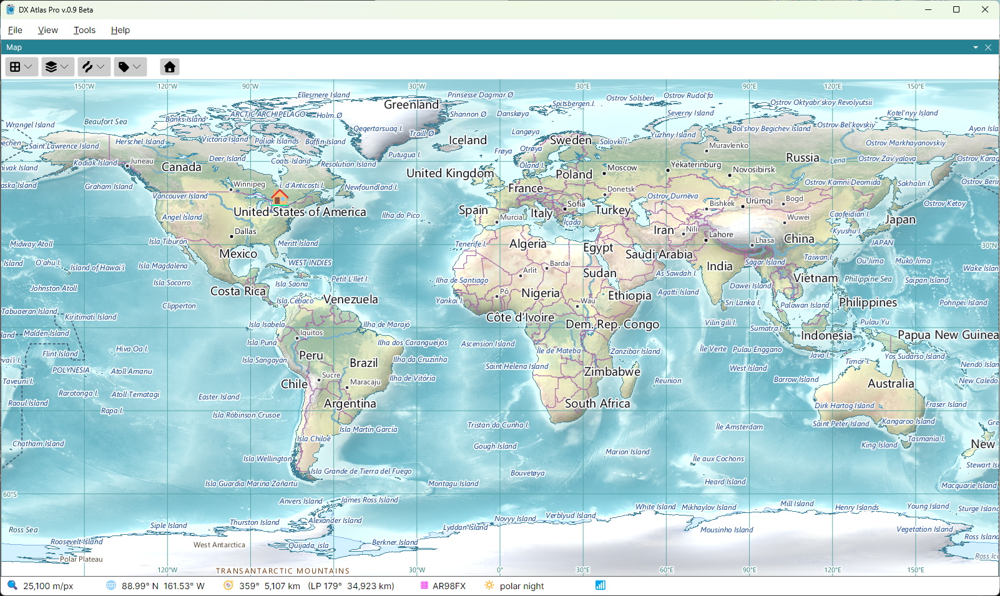

# Overview

DX Atlas Pro is a world atlas for Windows and Linux. It draws the Earth with shaded relief, land
cover and ocean depth, in three projections and on two independent map panels, with countries,
cities, rivers, lakes and time zones, the day and night terminator, and a clock that can show the
map at any date and time.

The program serves two audiences. With **Tools > Amateur Radio Functions** off, it is a
general-purpose atlas, and none of the Ham Radio terms appear in its menus and lists. With the
switch on, it becomes a tool for Radio Amateurs: DXCC entities and prefixes, prefix search, CQ
and ITU zones, IOTA groups, grid squares, award tracking, Great Circle paths, ionospheric maps,
the auroral oval and HF propagation prediction.

DX Atlas Pro is a new program. It is not an upgrade of DX Atlas, and
DX Atlas licences do not cover it; see [Register](https://ve3nea.github.io/DxAtlasPro/register.html).

## Features

### World Atlas

- three map projections: rectangular, azimuthal and globe, with zoom and pan;
- two map panels, each with its own projection, centre and zoom;
- shaded relief, land cover and ocean depth, with lakes, rivers, glaciers, ice shelves and urban
  areas;
- countries, provinces and states, and cities;
- time zones, and the local time of every country, city and island on the map, with summer time
  taken into account, at the current time or at any moment in the past since 1945;
- the day and night terminator, and sunrise and sunset at any point on the globe;
- the Clock panel: UTC or local time;
- the Lists panel: the items of every layer in lists, with search, a click on a row to find the item
  on the map and a click on the map to find it in the list;
- item details: the countries, zones, islands and other items at a point on the map, with their
  attributes;
- pins, and layers of your own, loaded from JSON files;
- named views, saved and restored from the menu;
- panels that can be docked or floated, light and dark themes, and the map colours set by the user;
- an automation API for other programs: a WebSocket API, and a COM interface compatible with
  DX Atlas 2 on Windows; see the [Developer's Guide](https://ve3nea.github.io/DxAtlasPro/developers_guide/overview.html).

### Amateur Radio

- prefix search: the DXCC entity of a callsign, found from its prefix;
- DXCC entities and their prefixes, in a tree of entities, their call areas and provinces;
- CQ zones, and ITU zones in both the ARRL and the RSGB versions;
- IOTA groups;
- VUCC grid squares and FFMA squares;
- award tracking: lists of the entities you worked or confirmed, per band or mode, shown in colour
  on the map;
- Great Circle paths from your home location, short path and long path;
- ionospheric maps computed with the IRI-2026 model: F2 layer critical frequency (foF2), MUF for
  3000 km, F2 layer peak height (hmF2), E layer critical frequency (foE), D layer peak electron
  density (NmD) and magnetic dip. The maps reflect the current conditions using the sunspot
  number and the Ap index downloaded automatically;
- the auroral oval in real time, from the NOAA Space Weather Prediction Center;
- HF propagation prediction maps computed with the DVOACAP engine: the signal strength from your
  station on the selected band and hour, updated in real time to reflect geomagnetic disturbances
  using the STORM model, and maps pre-computed for all bands and hours of the day.

*The real-time data - the auroral oval, the Ap index and the sunspot numbers - are available only
as long as the NOAA Space Weather Prediction Center, the GFZ Helmholtz Centre for Geosciences and
irimodel.org provide them on the web.*
