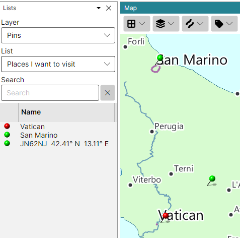

# Pins

Pins mark places of your choice on both maps: a friend's location, a place you plan to visit, a
station you worked. They are kept in lists on the **Pins** layer of the
[Lists Panel](lists_panel.md), and the maps show the pins of the list selected there.

## Creating a Pin List

Pins can be added only once a pin list exists:

1. in the Lists panel, pick **Pins** in the **Layer** box;
2. in the **List** box, pick **New List...** and type a name for the list.

You can keep several pin lists - one per trip, say - and switch between them in the List box. The
maps show the pins of the list selected on the Pins layer, even while the Lists panel shows another
layer.

## Adding a Pin

Right-click the map where the pin should go, open **Add Pin**, and pick one of the ten colours.
Without a pin list the item is disabled, and its tooltip says why.

A new pin is named by its grid square and its latitude and longitude.

## Editing and Removing Pins

- **On the map** - right-click a pin and pick **Remove Pin**;
- **In the Lists panel** - with the Pins layer selected, right-click the row of a pin:
  - **Edit Pin...** opens a dialog in which you can give the pin a name of your own and another
    colour. An empty name names the pin by its grid square and position again;
  - **Remove Pin** removes it.

Double-click a row to find its pin on the map. The pins are saved as soon as they change.

Pins are shown only while the Lists panel is open; closing the panel takes them off the maps.
