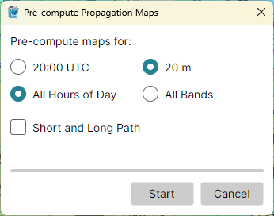

# Pre-computing Propagation

A propagation map takes a second or so to compute. To step through the hours of a day, or through
the bands, without waiting for each map, compute them in advance: pick
**Tools > Pre-compute Propagation Maps...**, shown with the Amateur Radio functions on.

## The Dialog

Under **Pre-compute maps for:**, choose:

- the current quarter hour, shown as its UTC time, or **All Hours of Day** - the 96 quarter hours
  of the 24 hours from now;
- the band the map shows, or **All Bands**;
- **Short and Long Path** - ticked, both paths are computed; cleared, the path the map shows.

Click **Start**. The dialog counts the maps done and shows a progress bar; maps already computed
are counted as done at once. While it runs, **Start** becomes **Stop**.

When the batch is done or stopped, the dialog says so and stays open, so you can start another;
its **Cancel** button becomes **Close**. Closing the dialog stops a batch that runs.

## When the Maps Are Used

The maps are kept on disk, in the user data folder, for the settings they were computed with. They
are shown at once when the Clock panel steps to their time, or when you pick their band or path.

A change of the home location, of a propagation setting, or of the sunspot number or Ap index
stops the batch, and the maps already computed no longer match; the dialog reports it. All Hours
of Day at All Bands on both paths is 1,728 maps, which takes several minutes even on a fast
computer.
