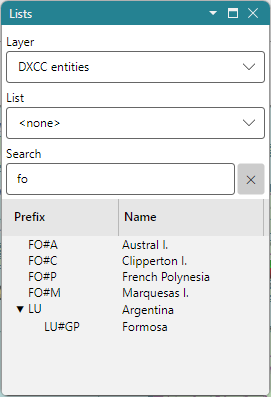

# Prefix Search

The **Search** box of the [Lists Panel](lists_panel.md) finds DXCC entities, call areas and
provinces. Pick the **DXCC entities** layer, and type any of these:

- a prefix, such as `UA0` or `KH6`;
- a full callsign, such as `VE3NEA` or `KH6/W1AW`;
- the name of an entity or a province, such as `Canada`.

There is no callsign database: the location of a callsign comes from its prefix alone.

- the list shows the DXCC entities whose prefixes match the callsign, and under each one the call
  area and the province the callsign belongs to, expanded: **VE3NEA** lists Canada, with its call
  area VE3;
- entities and provinces whose names match the text are listed too, after the prefix matches.

Double-click a row to find the entity on the map, or Ctrl-click it to see its
[Item Details](item_details.md).

## How the Text Is Read

The text is read as a callsign when it is one word of letters and digits, optionally with a `/`,
that holds a digit or a `/`, or is one or two letters: `VE3NEA`, `KH6/W1AW`, `UA0K`, `F`. Other
text, such as `USA`, is matched only against the names, so it finds the United States and not the
entities whose prefixes begin with those letters.

The callsign is matched against the prefix masks of every DXCC entity, call area and province,
and every record whose mask matches is listed, not only the most specific one. A portable prefix, such as `KH6/` in `KH6/W1AW`, is
matched as a prefix of its own. A partial prefix that no mask matches whole, such as `UT3` or `JT`,
lists the entities whose masks begin with it.

## The DXCC Tree

On the DXCC layer the list is a tree: each DXCC entity, with its call areas under it, and the
provinces or states under them. The prefix column shows each record's prefix, and the triangle
before a prefix opens and closes the rows under it.

See also [DXCC Entities and Prefixes](dxcc_entities.md).
