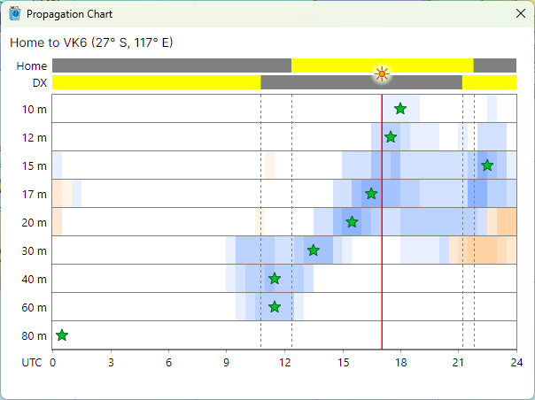

# The Propagation Chart

The propagation map answers "where can I work on this band right now?"; the chart answers the
opposite question: "when, and on which band, can I work this one place?" Use it to plan a QSO with a
DX station, to decide when to be on the air for a DXpedition, or to see whether a path you need is
worth trying today at all.

## Opening the Chart

Right-click the map at the place you want to work - a DXpedition's island, a station's grid square,
an entity you still need - and choose **Show Details > Propagation Chart**. The command is there while
the amateur radio functions are on. The chart is for the path from your home location to that point,
for your station as set in the **Propagation** section of the [Settings Dialog](settings.md), and for
the UTC day of the date the [Clock](clock.md) panel shows. Close it with **Esc**.

## Finding the Best Band and Time

Each row of the chart is a band and each column is half an hour of UTC; the darker a cell, the
stronger your signal at the DX end.

- **Pick the hour.** Look down a column for the darkest cell to see which band to use at that hour.
- **Pick the band.** Look along a row for the dark stretch to see when that band is open. The green
  star marks the band's best hour; a row with no star never opens to that point on that day.
- **Plan a session.** A path often moves up the bands as the day goes on and down again in the
  evening. Follow the dark cells from row to row to see when to change bands, and when the last band
  closes.

Hover over a cell for the exact reading in the status bar below the chart: the S-meter reading, the
UTC time and the local time at both ends, the take-off angle and the propagation mode. The readings
are for the station in the settings; for a bigger or smaller station, shift them by one S unit for
every 6 dB, as explained in [HF Propagation](reading_the_maps.md#hf-propagation).

## Short Path or Long Path

A blue cell means the short path is the better one at that time, an orange cell the long path, and
the status bar reads `SP` or `LP`. When you reach an orange stretch, turn the beam the other way, 180°
from the short-path bearing, and listen for the signal from that direction. Long-path openings are
often short and come at hours when the short path is closed, so the chart is the easiest way to
find them.

## Gray Line on the Low Bands

The two bars above the chart show daylight at your end and at the DX end, with dashed lines at
sunrise and sunset. On 80 and 40 m, look for the hours when your sunrise or sunset is close to the
DX station's sunrise or sunset: that is where a gray-line opening is most likely, and where the
chart often shows a short dark stretch on the low bands. Why the gray line helps is explained in
[Gray Line](reading_the_maps.md#gray-line).

## Choosing an Antenna

The take-off angle in the status bar tells you which antenna will do the job: a long path usually
needs a low angle, a few degrees above the horizon, which favours a high beam or a vertical over a
low dipole. If you have several antennas, use the one that is strongest at that angle.

## Planning Ahead

The chart is computed for the date the Clock panel shows, at the moment it opens. To plan for a
later date - the start of a DXpedition, say - set the Clock panel to that date, then open the chart
again. The red vertical line marks the time the Clock panel shows; while the Clock panel follows the
current time, the line moves with it, so you can leave the chart open during an operating session.

## From the Chart Back to the Map

When the chart shows a good band and hour for one place, show that band on the
[propagation map](propagation_prediction.md) and set the Clock panel to that hour to see where else
the band is open at the same time - other stations you could work during the same opening.
