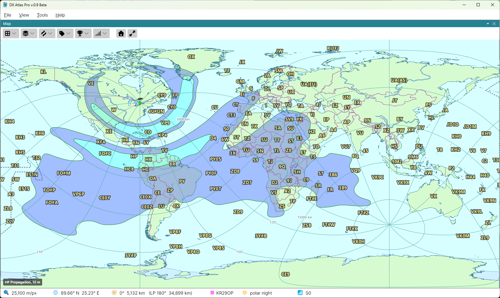

# Propagation Prediction

The propagation map shows how strong your signal would be at every point of the globe on one band,
at the time the [Clock](clock.md) panel shows. It is computed by the program with the DVOACAP
engine based on the VOACAP algorithms, from your home location, the band, and your station as set in the
**Propagation** section of the [Settings Dialog](settings.md).

## Showing the Map

Open the **Ionosphere** button on the map toolbar:

- tick **HF Propagation** to show the map in place of an ionospheric map;
- pick the band in the **Band** submenu: 80, 60, 40, 30, 20, 17, 15, 12 or 10 m;
- tick **Long Path** to compute the signal along the long path, the longer arc of the great circle
  around the Earth, instead of the short path.

The band and Long Path are the same for both maps; HF Propagation is ticked for each map
separately.

## Reading the Map

The map is drawn in bands of S-meter readings, from S1 up to S9+12 dB, with a green line at each
band edge; below S1 it is left clear. The legend in the lower left corner names the band, with
**LP** after it on the long path. The status bar's 📶 cell shows the reading at the point under the
mouse: `S7`, or `S9 + 10 dB`.

How to read the map, and how many S units to add or subtract when your station differs from the
settings, is explained in [HF Propagation](reading_the_maps.md#hf-propagation) on the
*Reading the Maps for DX'ing* page.

## Live Updates

The map is computed for a quarter hour of UTC, and changes when the clock enters the next one. With
the clock live, the program computes the maps of the next 3 hours in the background, so they are
ready when they are needed. With **Use STORM Model** ticked in the Ionospheric Parameters dialog,
the map follows geomagnetic disturbances as the Ap index is downloaded; see
[Ionospheric Maps](ionospheric_maps.md).

A change of the band, the path, the home location or a setting starts the map again at once; while
it is computed, the status bar shows `…`. The maps already computed are kept on disk, so a return
to earlier settings, or a restart, needs no new computation.

## The Propagation Settings

The **Propagation** section of the Settings dialog sets what the map is computed for:

- **Transmitter Power, W** - your transmitter's power, 100 W by default;
- **Transmit Antenna Gain, dBi** - the gain of your antenna over an isotropic one, the same in
  every direction;
- **Receive Antenna Gain, dBi** - the gain of the antennas at the receiving end;
- **Minimum Takeoff Angle, °** - the lowest elevation angle the antennas radiate at, 3° by default;
- **Man-made Noise** - the noise at the receiving end: **Industrial**, **Residential**, **Rural** or
  **Remote**;
- **Grid Resolution** - the spacing of the points the map is computed at, **3°** or **1.5°**. The
  finer grid takes four times as long;
- **Threads** - the number of processor threads that compute the map, 0 for one per processor.

To compute the maps of a whole day in advance, see
[Pre-computing Propagation](precompute_propagation.md).
