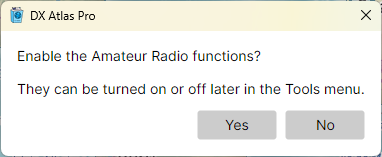

# Quick Start

## First Start

When DX Atlas Pro starts for the first time, it asks whether to enable the Amateur Radio functions:

- answer **Yes** to show the DXCC entities, zones, award tracking, ionospheric maps and propagation
  prediction;
- answer **No** to use the program as a general-purpose world atlas.

The answer is not final: **Tools > Amateur Radio Functions** turns the functions on and off at any
time. See [The Amateur Radio Switch](amateur_radio_switch.md).

## Setting the Home Location

The home location is your own location on the globe. It is marked on both maps, the distances and
bearings in the status bar are measured from it, the Clock panel shows its sunrise and sunset, and
the azimuthal map is centred on it.

To set it, do one of the following:

- right-click your location on the map and pick **Set Home Location Here**, then confirm the
  coordinates in the message box;
- open **Tools > Settings**, and enter your latitude and longitude, or your Maidenhead grid square,
  in the **Home Location** section.

See [Home Location](home_location.md).

## Finding Your Way Around

- drag the map with the left mouse button to pan it, and turn the mouse wheel to zoom in and out;
- click the **Projection** button at the left end of the map toolbar to switch between the
  rectangular map, the azimuthal map and the globe;
- click the **Layers**, **Lines** and **Labels** buttons to choose what the map shows;
- hover the mouse over a label to see its tooltip, and right-click the map for a menu of what you
  can do at that point;
- type a name in the **Search** box of the **Lists** panel, then double-click a row to find that
  item on the map.

The rest of this guide describes each of these in detail. [Window Layout](window_layout.md) explains
the panels of the main window.
