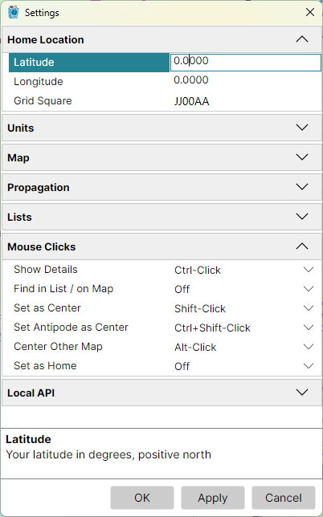

# Settings Dialog

**Tools > Settings** opens the Settings dialog: a list of settings in sections, each section
folding open to its fields.

- click a field to edit it; its description is shown under the list;
- right-click a field's name and pick **Reset** to return it to its default value;
- **OK** applies the changes and closes the dialog, **Apply** applies them and keeps it open, and
  **Cancel** discards the changes not yet applied.

A grid square that is not a valid Maidenhead locator, or two mouse click actions given the same
keys, are reported when you click OK or Apply, and nothing is applied until they are corrected.

## Home Location

Your location, marked on both maps; see [Home Location](home_location.md).

- **Latitude** - in degrees, positive north;
- **Longitude** - in degrees, positive east;
- **Grid Square** - your 4- or 6-character Maidenhead locator. Entering it moves the latitude and
  longitude to the centre of the square.

## Units

- **Distance** - **km / m**, **Miles / Feet** or **Nautical Miles / Feet**: the first unit for the
  distances in the status bar and on the map, the second for the elevation and the map scale in
  the status bar.

## Map

The settings both maps share:

- **Gray Line Update Interval** - how often the gray line is redrawn as the sun moves, in seconds;
- **Gray Line** - the parts of the gray line drawn while it is on, and where its night shadow begins:
  - **Sun** - the sun glyph at the point where the sun is overhead;
  - **Terminator** - the line between day and night;
  - **Twilight Shadow** - a lighter band between the terminator and the night shadow;
  - **Night Shadow** - the darker shadow over the night side;
  - **Twilight** - where the twilight shadow ends and the night shadow begins: at the end of
    **Civil**, **Nautical** or **Astronomical** twilight, with the sun 6°, 12° or 18° under the
    horizon.

## Propagation

What the propagation map is computed for; see
[Propagation Prediction](propagation_prediction.md). This section is shown only with the
[Amateur Radio functions](amateur_radio_switch.md) on.

## Lists

- **Name Search** - how the Search box of the [Lists Panel](lists_panel.md) matches names:
  **Exact**, by their letters, ignoring case, or **Phonetic**, by their sound, so *Gray* finds
  *Grey*.

## Mouse Clicks

The keys held with a click for each action, on a map or on a row of the Lists panel. Each action
can be given **Click**, **Ctrl-Click**, **Shift-Click**, **Alt-Click**, **Ctrl+Shift-Click**,
**Ctrl+Alt-Click** or **Alt+Shift-Click**, or **Off** for no keys. No two actions may have the same
keys, but any number may be off. Every action is also in the map's context menu, whatever its keys.

| Action | Default | What it does |
|---|---|---|
| **Show Details** | Ctrl-Click | shows the [Item Details](item_details.md) of what is under the click, or of the row clicked |
| **Find in List / on Map** | Off | on a map, selects the item clicked in the Lists panel; on a row, finds its item on the map |
| **Set as Center** | Shift-Click | centres the azimuthal map on the point clicked |
| **Set Antipode as Center** | Ctrl+Shift-Click | centres the azimuthal map on the point opposite the one clicked |
| **Center Other Map** | Alt-Click | centres the other map on the point clicked |
| **Set as Home** | Off | makes the point clicked your home location, once you confirm it |

A plain click on a label shows its Item Details unless an action has been given **Click**.

## API

The WebSocket API through which other programs on this computer drive the maps: the **Port** they
connect to, and the **Allowed Origins**, the web pages that may connect. See the
[Developer's Guide](https://ve3nea.github.io/DxAtlasPro/developers_guide/overview.html).
