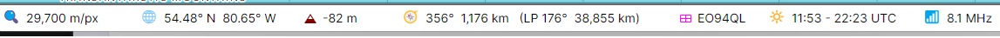

# Status Bar

The status bar at the bottom of the main window describes the point under the mouse, on either
map:

- 🔍 **Map scale** - the scale of the map under the mouse, in metres or feet per pixel. While the
  mouse is off the maps, the scale of the map you last clicked;
- 🌐 **Latitude and longitude** of the point;
- ▲ **Elevation** - the height of the ground or the ice above sea level at the point, or the depth
  of the sea there as a negative number. It is an average over about 15 km, so a summit reads lower
  than its true height, and a point near the coast reads between the land and the sea;
- 🧭 **Azimuth and distance from home** - the bearing and the distance from your home location to
  the point along the great circle, then, after **LP**, the same along the long path: the opposite
  bearing and the rest of the great circle around the Earth;
- ⊞ **Grid square** - the 6-character Maidenhead locator of the point;
- 🔆 **Sunrise and sunset** at the point, in UTC or local time as the **UTC** and **Local**
  switch of the [Clock](clock.md) panel selects, on the day the panel shows, or **polar day** or
  **polar night** where the sun does not rise or set that day;
- 📶 **Map reading** - with the Amateur Radio functions on, the value of the ionospheric or
  propagation map at the point; see [Ionospheric Maps](ionospheric_maps.md).

Hover the mouse over a value to see what it is. The distances, the elevation and the map scale are
shown in the units chosen in the **Units** section of the [Settings Dialog](settings.md):
kilometres and metres, miles and feet, or nautical miles and feet.
