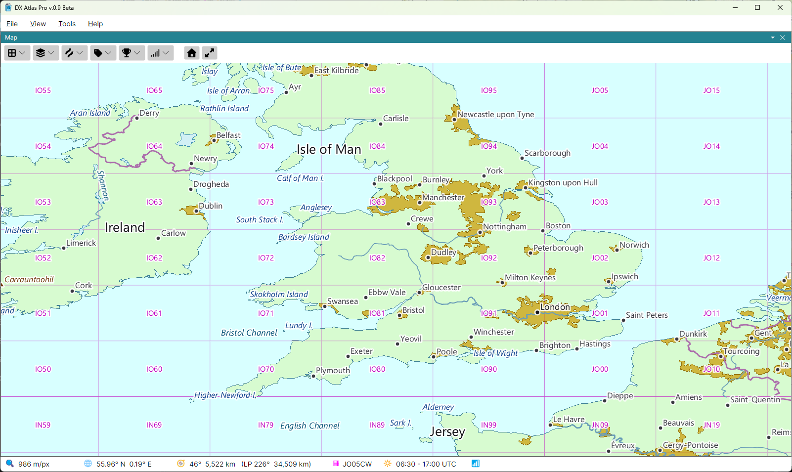

# VUCC Grid Squares

**VUCC Grid Squares** in the **Amateur Radio** menu draws the Maidenhead locator grid, used by the
ARRL's VHF/UHF Century Club award and by VHF contesters:

- at a world view, the 324 fields, 20 by 10 degrees, labelled **AA** to **RR**;
- zoomed in, the 32,400 squares, 2 by 1 degrees, labelled with their four characters, such as
  **FN03**.

The grid is drawn by the program as you zoom, so it is sharp at every scale.

The status bar always shows the 6-character locator of the point under the mouse; see
[Status Bar](status_bar.md).
