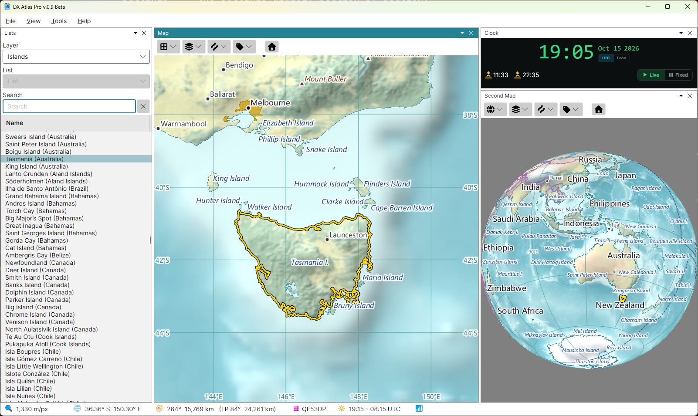
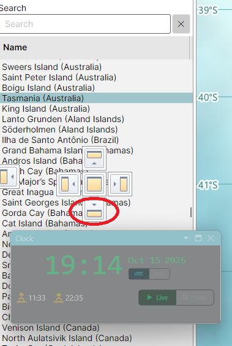

# Window Layout

The main window holds the main menu at the top, the status bar at the bottom, and four panels
between them:

- **Lists** - the layers of the map as lists of items, with search; see
  [The Lists Panel](lists_panel.md);
- **Map** and **Second Map** - two independent map panels, each with its own toolbar, projection,
  centre, zoom and layers; see [The Map](navigating_the_map.md);
- **Clock** - the current time, or a time of your choice for the gray line; see
  [Clock and Fixed Time](clock.md).

## Showing and Hiding Panels

The **View** menu has a checkbox for each panel: tick it to show the panel, clear it to hide the
panel. A panel can also be closed by the close button on its tab. When the program starts for the
first time, the Lists panel and the Map are shown, and the Second Map and the Clock panel are
hidden; show them with **View > Second Map** and **View > Clock**.

Closing a panel has these side effects:

- closing the **Clock** panel returns the clock to the computer's time, so the maps do not stay at
  a forgotten fixed time;
- closing the **Lists** panel removes the highlight, the pins and the award colouring from the maps,
  and showing it again puts them back.

The status bar is always shown.

## Docking and Floating

Each panel can be docked - placed inside the main window, beside, above or below another panel, or
on a tab in the same group as another panel - or floated in a window of its own.

### Moving a Panel

To move a docked panel, drag its tab, the strip with its name at the top of the panel. To move a
floating panel, drag the title bar of its window.

While you drag, docking targets appear over the panel under the mouse cursor: a cross of five
buttons in the middle of that panel, and a button at the edge of the main window. Each button
shows, in its picture, where the panel will go:

- the **top**, **bottom**, **left** and **right** buttons of the cross split the panel under the
  cursor, and put the dragged panel above it, below it, or beside it;
- the **centre** button puts the dragged panel on a tab in the same group as the panel under the
  cursor, so that the two take turns in the same place;
- a button at the **edge of the main window** docks the dragged panel along that whole edge.

What counts is where the **mouse cursor** is when you release the button, not where the dragged
panel or its window is: move the cursor itself onto the target button. Releasing it anywhere else
leaves the panel floating in a window of its own, which you can move to another monitor.

### Example: the Clock Below the Lists

To dock the Clock panel below the Lists panel:

1. show the Clock panel with **View > Clock**;
2. drag the Clock panel by its tab, or by the title bar of its window if it is floating, over the
   Lists panel. The docking targets appear over the Lists panel;
3. move the mouse cursor onto the **bottom** button of the cross, the one circled in the picture
   below, and release the mouse button.

The Lists panel is split in two, the list above and the Clock below.

### Sizes and Saving

Drag the splitters between the panels to resize them. The layout, including the size and position
of any floating window, is saved when the program closes and restored the next time it starts.
To save several layouts and switch between them, use [Named Views](named_views.md).

## Themes

**Tools > Theme** switches the program between the **Light** and the **Dark** theme. The theme
changes the menus, panels and dialogs; the map colours are set separately, in the
[Colors Dialog](colors.md). The Clock panel is dark in either theme.
